# Library of Things (CircuLend) — Comprehensive Technical & Functional Documentation

---

## Table of Contents
1. [Project Overview and Architecture](#1-project-overview-and-architecture)
   - [1.1 Purpose and Real-World Problem](#11-purpose-and-real-world-problem)
   - [1.2 Technology Stack](#12-technology-stack)
   - [1.3 System Architecture](#13-system-architecture)
   - [1.4 Request Lifecycle & Data Flow](#14-request-lifecycle--data-flow)
   - [1.5 Directory & File Anatomy](#15-directory--file-anatomy)
2. [Complete Database Schema and Table Relationships](#2-complete-database-schema-and-table-relationships)
   - [2.1 Catalog Tools vs. Physical Tool Units](#21-catalog-tools-vs-physical-tool-units)
   - [2.2 Complete Table Inventory](#22-complete-table-inventory)
   - [2.3 Mermaid Entity-Relationship (ER) Diagram](#23-mermaid-entity-relationship-er-diagram)
3. [PostgreSQL Functions, Stored Procedures, Triggers, Constraints, and Views](#3-postgresql-functions-stored-procedures-triggers-constraints-and-views)
   - [3.1 Helper Functions](#31-helper-functions)
   - [3.2 Database Triggers](#32-database-triggers)
   - [3.3 Stored Procedures](#33-stored-procedures)
   - [3.4 Database Views](#34-database-views)
   - [3.5 Architectural Separation of Responsibilities](#35-architectural-separation-of-responsibilities)
4. [Exact End-to-End Workflows](#4-exact-end-to-end-workflows)
   - [Workflow A: User Registration](#workflow-a-user-registration)
   - [Workflow B: Login, Authentication & Role Isolation](#workflow-b-login-authentication--role-isolation)
   - [Workflow C: Equipment Catalogue & Availability Discovery](#workflow-c-equipment-catalogue--availability-discovery)
   - [Workflow D: Single Equipment Reservation & Overlap Prevention](#workflow-d-single-equipment-reservation--overlap-prevention)
   - [Workflow E: Administrator Equipment Handover (Checkout)](#workflow-e-administrator-equipment-handover-checkout)
   - [Workflow F: Equipment Return & Automated Waitlist Cascade](#workflow-f-equipment-return--automated-waitlist-cascade)
   - [Workflow G: Deposit Management & Dashboard Financial Accounting](#workflow-g-deposit-management--dashboard-financial-accounting)
   - [Workflow H: Waitlist Administration, FIFO Ordering & Promotions](#workflow-h-waitlist-administration-fifo-ordering--promotions)
   - [Workflow I: Equipment Kits (Multi-Component Atomic Reservations)](#workflow-i-equipment-kits-multi-component-atomic-reservations)
   - [Workflow J: Staff Desk Operations](#workflow-j-staff-desk-operations)
   - [Workflow K: Damage Reporting & Repair Bench Quarantine](#workflow-k-damage-reporting--repair-bench-quarantine)
   - [Workflow L: Dashboard & Analytics Engine](#workflow-l-dashboard--analytics-engine)
   - [Workflow M: Concurrency Laboratory & Race Condition Defense](#workflow-m-concurrency-laboratory--race-condition-defense)
   - [Workflow N: Member Account Center, Notifications & Borrowing History](#workflow-n-member-account-center-notifications--borrowing-history)
5. [Business Rules and State Transitions](#5-business-rules-and-state-transitions)
   - [5.1 Physical Units Lifecycle](#51-physical-units-lifecycle)
   - [5.2 Reservations Lifecycle](#52-reservations-lifecycle)
   - [5.3 Loans Lifecycle](#53-loans-lifecycle)
   - [5.4 Deposits Lifecycle](#54-deposits-lifecycle)
   - [5.5 Waitlist Queue Lifecycle](#55-waitlist-queue-lifecycle)
6. [Security, Integrity, and Error Handling](#6-security-integrity-and-error-handling)
   - [6.1 Password Security & Policies](#61-password-security--policies)
   - [6.2 JWT Tokens & Session Security](#62-jwt-tokens--session-security)
   - [6.3 Role-Based Access Control (RBAC) & Route Isolation](#63-role-based-access-control-rbac--route-isolation)
   - [6.4 Row-Level Security (RLS) in PostgreSQL](#64-row-level-security-rls-in-postgresql)
   - [6.5 SQL Injection Defense & Parameterization](#65-sql-injection-defense--parameterization)
   - [6.6 Exclusion Constraints & GiST Indexing](#66-exclusion-constraints--gist-indexing)
   - [6.7 Transaction Isolation & Concurrency Control](#67-transaction-isolation--concurrency-control)
   - [6.8 PostgreSQL Error Codes & Exception Mapping](#68-postgresql-error-codes--exception-mapping)
7. [Demo Database and Seed Data](#7-demo-database-and-seed-data)
   - [7.1 Database Initialization Sequence](#71-database-initialization-sequence)
   - [7.2 Seed Data Breakdown](#72-seed-data-breakdown)
   - [7.3 Built-in Demo Accounts](#73-built-in-demo-accounts)
   - [7.4 Safe Database Inspection & Reset Procedures](#74-safe-database-inspection--reset-procedures)
8. [Beginner-Friendly SQL Examples](#8-beginner-friendly-sql-examples)
9. [Troubleshooting Guide](#9-troubleshooting-guide)
10. [Teacher / Viva Preparation](#10-teacher--viva-preparation)
    - [10.1 System Elevator Pitch](#101-system-elevator-pitch)
    - [10.2 Core Database Concepts Demonstrated](#102-core-database-concepts-demonstrated)
    - [10.3 28 Likely Viva Questions & Codebase Answers](#103-28-likely-viva-questions--codebase-answers)
    - [10.4 Why PostgreSQL? (Beyond Basic CRUD)](#104-why-postgresql-beyond-basic-crud)

---

# 1. Project Overview and Architecture

### 1.1 Purpose and Real-World Problem
Most households own tools that are used rarely (e.g., a power drill is used on average for only 13 minutes in its entire lifespan). Buying, storing, and disposing of single-use items creates financial strain and domestic clutter, driving electronic waste and unnecessary consumption. 

**CircuLend (Library of Things)** is a community-oriented web application designed to support a circular sharing economy. It enables community members to borrow tools, equipment, camping gear, and appliances on demand, while providing community tool libraries with an enterprise-grade custody management system. 

The system solves critical operational problems:
- **Inventory Contention:** Prevents double-booking of scarce tools during overlapping dates using mathematical exclusion constraints.
- **Fair Allocation:** Manages high-demand items using automated First-In, First-Out (FIFO) waitlist queues that automatically promote waiting members when equipment is returned.
- **Deposit Custody & Safety:** Enforces transparent security deposits with mandatory holding and return inspection windows before deposits can be refunded.
- **Damage Quarantine:** Automatically removes damaged tools from circulation to prevent broken items from being handed over to waiting patrons.
- **Multi-Tool Kits:** Guarantees atomic all-or-nothing reservations for multi-component kits (e.g., Tiling Starter Kit) so members never receive an incomplete set.

---

### 1.2 Technology Stack

| Layer | Technology | Version | Purpose in Project |
| :--- | :--- | :--- | :--- |
| **Frontend** | Vanilla HTML5, CSS3, ES6+ JavaScript | Modern Web Standards | Single-page responsive interface, tab switching, modal dialogs, real-time toast feedback without heavy JavaScript frameworks. |
| **Styling** | Custom CSS Variables, Flexbox, CSS Grid | CSS3 | Responsive form layouts, 38px standardized controls, clear contrast badges, and mobile-friendly layouts. |
| **Backend** | Python / Flask | Python 3.12+ / Flask 3.1+ | Lightweight RESTful API handling HTTP routing, JWT token generation, cookie management, and transaction boundaries. |
| **Database Connector** | `psycopg2-binary` | 2.9+ | High-performance PostgreSQL database adapter managing thread-safe connection pooling via `ThreadedConnectionPool`. |
| **Authentication** | PyJWT & `pgcrypto` | PyJWT 2.10+ / PostgreSQL 16 | Stateless JSON Web Tokens (JWT) combined with database-level bcrypt hashing (`crypt` / `gen_salt('bf')`). |
| **Database Engine** | PostgreSQL | PostgreSQL 16 | Relational persistence, PL/pgSQL stored procedures, triggers, views, row-level security (RLS), and Generalized Search Tree (`btree_gist`) exclusion constraints. |
| **Containerization** | Docker & Docker Compose | Docker Engine 24+ / Compose v2 | Reproducible container configuration hosting PostgreSQL on port `5432` with a persistent named Docker volume (`pgdata`). |
| **Testing** | `pytest` | 8.3+ / 9.1+ | Automated test suite with 86 integration, security, concurrency, and UI regression tests. |

---

### 1.3 System Architecture

The project follows a **Database-First, Guarded Architecture** where core business rules, concurrency locks, and state invariants are enforced directly inside PostgreSQL rather than in fragile application code.

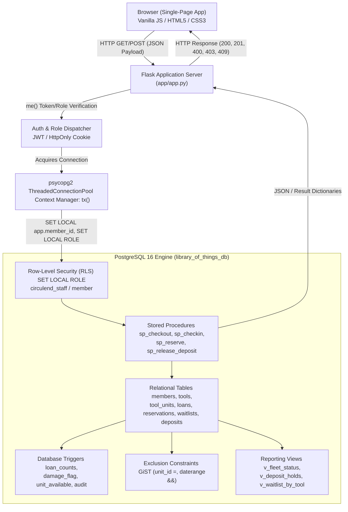

---

### 1.4 Request Lifecycle & Data Flow

Every user action proceeds through a strict 8-step lifecycle:

1. **User Interaction:** The user clicks a button (e.g., **Hand over equipment** on Staff Desk).
2. **Client Dispatch:** Modern ES6 JavaScript calls `api(endpoint, {body: payload})` using the native `fetch` API, automatically sending the JWT in `Authorization: Bearer <token>` and `Cookie: token=<jwt>`.
3. **Route Handling & Authentication:** Flask routes the request (e.g., `@app.post("/api/staff/checkout")`). It calls `me(staff=True)`:
   - Decodes and verifies the JWT signature and expiration.
   - Rejects unauthenticated requests with `401 Unauthorized`.
   - Rejects non-staff users attempting staff actions with `403 Forbidden`.
4. **Transaction Context Creation:** The backend opens a transactional context using Python's context manager `@contextlib.contextmanager def tx(role, member_id)`:
   - Obtains a connection from `psycopg2.pool.ThreadedConnectionPool`.
   - Executes `SELECT set_config('app.member_id', %s, true)` for Row-Level Security.
   - Executes `SET LOCAL ROLE circulend_staff` (or `circulend_member`).
5. **Database Execution:** Flask calls a stored procedure (e.g., `SELECT sp_checkout(unit_id, member_id, days, reservation_id)`).
6. **Trigger & Constraint Enforcement:** 
   - PostgreSQL acquires a row lock (`FOR UPDATE`).
   - Triggers fire automatically (e.g., `trg_loan_counts` updates the member's active loan count).
   - If constraints or availability checks fail, PostgreSQL raises a PL/pgSQL exception, aborting the transaction immediately with zero partial updates.
7. **Commit & Connection Release:** On successful completion, `con.commit()` commits all changes atomically; the connection is returned to the pool.
8. **Client Rendering & Toast:** Flask returns JSON. The frontend calls `toast(message, 'ok')` and re-renders only the affected DOM components.

---

### 1.5 Directory & File Anatomy

```text
Library_of_Things/
├── app/
│   ├── app.py                  # Primary Flask backend: API endpoints, JWT auth, tx() connection pool manager
│   └── static/
│       └── index.html          # Frontend single-page app (HTML5, responsive CSS, ES6 client logic)
├── db/
│   ├── 01_schema.sql           # Database DDL: types, tables, primary/foreign keys, check & exclusion constraints
│   ├── 02_logic.sql            # Database logic: triggers, PL/pgSQL stored procedures, reporting views
│   ├── 03_security.sql         # Security DDL: PostgreSQL roles, GRANT permissions, Row-Level Security policies
│   └── seed.py                 # Idempotent database seeder with realistic community demo data
├── tests/
│   ├── conftest.py             # Pytest fixtures, test database setup, Q helper, test isolation
│   ├── test_auth.py            # Authentication, password policy, and JWT validation tests
│   ├── test_circulend.py       # Core test suite verifying business procedures TC-01 through TC-70
│   └── test_ui_and_fixes.py    # Regression tests for auto-login, kits, waitlists, deposits, and loan limits
├── docker-compose.yml          # Docker Compose specification for PostgreSQL 16 container
├── Dockerfile                  # Web application container specification
├── requirements.txt            # Python dependencies (Flask, psycopg2-binary, pyjwt, pytest)
├── pytest.ini                  # Pytest configuration
├── .env                        # Local database and secret configuration (excluded from version control)
├── .env.example                # Example environment configuration template
└── PROJECT_DOCUMENTATION.md    # Master technical and functional project documentation
```

---

# 2. Complete Database Schema and Table Relationships

### 2.1 Catalog Tools vs. Physical Tool Units

A foundational architectural strength of CircuLend is the strict separation between an **Equipment Model/Type** (`tools`) and an **Individual Physical Unit** (`tool_units`):

- **`tools` (The Abstract Catalog Item):** Represents what a tool is conceptually (e.g., *"Bosch 18V Cordless Drill"*). It stores catalog metadata: category, description, deposit amount (e.g., ₹1,500), and maximum allowed borrowing days (e.g., 7 days).
- **`tool_units` (The Concrete Physical Assets):** Represents the actual physical machines sitting on the shelf (e.g., Unit #1 with serial number `SN-DR-001`, Unit #2 with serial `SN-DR-002`). Each physical unit independently tracks:
  - Its own mechanical **`condition_status`** (`Good`, `Fair`, `Needs Inspection`, `Repair`).
  - Its own operational **`status`** (`Available`, `Reserved`, `Loaned`, `Repair`, `Retired`).

*Why this matters:* A member reserves a *Drill*, but when collecting the tool at the desk, the administrator hands over a specific *Unit #2*. If Unit #2 is returned damaged, only Unit #2 is quarantined to the repair bench; Unit #1 remains available on the shelf for other members.

---

### 2.2 Complete Table Inventory

CircuLend contains **13 relational tables** and **3 enumerated custom types**:

#### Custom ENUM Types
1. **`unit_status`**: `'Available'`, `'Reserved'`, `'Loaned'`, `'Repair'`, `'Retired'`
2. **`condition_state`**: `'Good'`, `'Fair'`, `'Needs Inspection'`, `'Repair'`
3. **`severity_level`**: `'Minor'`, `'Moderate'`, `'Major'`, `'Critical'`

---

#### Table 1: `settings`
- **Purpose:** Centralized, database-backed operational key-value configuration. Avoids hardcoding operational constants in application code.
- **Columns:**
  - `key` (`text`, PRIMARY KEY): Parameter name.
  - `value` (`text`, NOT NULL): Parameter value string.
- **Default Seed Records:**
  - `deposit_hold_hours` = `'24'` (mandatory post-return inspection window).
  - `reservation_hold_hours` = `'48'` (time a promoted waitlist member has to collect equipment).
  - `late_fee_per_day` = `'20'` (late fine in INR per overdue day).
  - `default_max_loans` = `'4'`.
- **Read by:** `setting_int()` in stored procedures and database triggers.

---

#### Table 2: `categories`
- **Purpose:** Classifies equipment for catalog navigation and fleet utilization analytics.
- **Columns:**
  - `category_id` (`serial`, PRIMARY KEY): Auto-incrementing identifier.
  - `name` (`text`, NOT NULL, UNIQUE): Unique category name (e.g., *"Power Tools"*, *"Gardening"*, *"Camping"*).
- **Relationships:** Referenced by `tools.category_id` (1:N).

---

#### Table 3: `members`
- **Purpose:** Stores user accounts, credentials, contact details, roles, and denormalized loan counters.
- **Columns:**
  - `member_id` (`serial`, PRIMARY KEY): Unique member number.
  - `name` (`text`, NOT NULL): Full name (enforces `length(trim(name)) > 0`).
  - `email` (`text`, NOT NULL, UNIQUE): Case-insensitive email (enforces regex format).
  - `contact` (`text`, NULLABLE): Phone number.
  - `password_hash` (`text`, NOT NULL): Cryptographic Blowfish bcrypt hash (`crypt(pw, gen_salt('bf'))`).
  - `role` (`text`, NOT NULL, DEFAULT `'member'`): Enforces `role IN ('member', 'staff', 'admin')`.
  - `join_date` (`date`, NOT NULL, DEFAULT `current_date`).
  - `active` (`boolean`, NOT NULL, DEFAULT `true`): Deactivated members cannot borrow.
  - `max_loans` (`int`, NULLABLE): Account-specific loan limit. If `NULL`, member is unconstrained.
  - `active_loans_count` (`int`, NOT NULL, DEFAULT `0`): Controlled denormalization maintained exclusively by `trg_loan_counts`.
- **Relationships:** Referenced by `loans`, `reservations`, `waitlists`, `notifications`.

---

#### Table 4: `tools`
- **Purpose:** Abstract equipment catalog definitions.
- **Columns:**
  - `tool_id` (`serial`, PRIMARY KEY): Catalog item ID.
  - `name` (`text`, NOT NULL, UNIQUE): Unique tool model name.
  - `category_id` (`int`, NOT NULL, FK `categories(category_id)` ON DELETE RESTRICT).
  - `description` (`text`, NULLABLE): Tool specifications and usage instructions.
  - `deposit_amount` (`numeric(8,2)`, NOT NULL, DEFAULT `0`, CHECK `>= 0`): Caution deposit in INR.
  - `max_loan_days` (`int`, NOT NULL, DEFAULT `7`, CHECK `BETWEEN 1 AND 60`): Maximum allowed duration.
- **Relationships:** 1:N with `tool_units`, 1:N with `kit_components`, 1:N with `waitlists`.

---

#### Table 5: `tool_units`
- **Purpose:** Concrete physical equipment items tracked in the library inventory.
- **Columns:**
  - `unit_id` (`serial`, PRIMARY KEY): Surrogate key for foreign key convenience.
  - `tool_id` (`int`, NOT NULL, FK `tools(tool_id)` ON DELETE CASCADE).
  - `unit_no` (`int`, NOT NULL, CHECK `> 0`): Human-readable unit sequence (Unit #1, Unit #2).
  - `serial_no` (`text`, UNIQUE, NULLABLE): Manufacturer hardware serial number.
  - `condition_status` (`condition_state`, NOT NULL, DEFAULT `'Good'`).
  - `status` (`unit_status`, NOT NULL, DEFAULT `'Available'`).
  - `acquired_on` (`date`, NOT NULL, DEFAULT `current_date`).
- **Constraints:**
  - `UNIQUE (tool_id, unit_no)`: Prevents duplicate unit numbers per tool model.
  - `chk_repair_not_offered`: `CHECK (NOT (condition_status = 'Repair' AND status IN ('Available','Reserved')))` — Database-level mathematical invariant guaranteeing that damaged units cannot be booked.

---

#### Table 6: `loans`
- **Purpose:** Records physical borrowings of equipment units by members.
- **Columns:**
  - `loan_id` (`serial`, PRIMARY KEY): Unique borrowing ID.
  - `unit_id` (`int`, NOT NULL, FK `tool_units(unit_id)`).
  - `member_id` (`int`, NOT NULL, FK `members(member_id)`).
  - `loan_date` (`date`, NOT NULL, DEFAULT `current_date`).
  - `due_date` (`date`, NOT NULL): Expected return date.
  - `return_date` (`date`, NULLABLE): Actual return date (`NULL` while currently out).
  - `status` (`text`, NOT NULL, DEFAULT `'Active'`, CHECK `IN ('Active','Returned','Overdue','Lost')`).
  - `late_fee` (`numeric(8,2)`, NOT NULL, DEFAULT `0`, CHECK `>= 0`): Calculated late penalty.
- **Constraints:**
  - `chk_due_after_loan`: `CHECK (due_date >= loan_date)`.
  - `chk_return_after_loan`: `CHECK (return_date IS NULL OR return_date >= loan_date)`.
  - `chk_status_return`: `CHECK (status = 'Lost' OR ((status = 'Returned') = (return_date IS NOT NULL)))`.
  - Unique Index `uq_one_open_loan_per_unit`: `CREATE UNIQUE INDEX ... ON loans(unit_id) WHERE return_date IS NULL AND status <> 'Lost'`. Ensures at the storage layer that a physical machine can never be loaned to two people at once.

---

#### Table 7: `reservations`
- **Purpose:** Advance bookings of physical units for specific calendar dates.
- **Columns:**
  - `reservation_id` (`serial`, PRIMARY KEY): Unique booking ID.
  - `unit_id` (`int`, NOT NULL, FK `tool_units(unit_id)`).
  - `member_id` (`int`, NOT NULL, FK `members(member_id)`).
  - `reserved_for_date` (`date`, NOT NULL): Planned start date.
  - `duration_days` (`int`, NOT NULL, DEFAULT `3`, CHECK `BETWEEN 1 AND 60`).
  - `status` (`text`, NOT NULL, DEFAULT `'Active'`, CHECK `IN ('Active','Fulfilled','Cancelled','Expired')`).
  - `created_at` (`timestamptz`, NOT NULL, DEFAULT `now()`).
  - `expires_at` (`timestamptz`, NOT NULL): Collection deadline before auto-expiry.
  - `source` (`text`, NOT NULL, DEFAULT `'direct'`, CHECK `IN ('direct','waitlist','kit')`).
- **Exclusion Constraint:**
  - `excl_no_overlap`:
    ```sql
    CONSTRAINT excl_no_overlap EXCLUDE USING gist (
        unit_id WITH =,
        daterange(reserved_for_date, reserved_for_date + duration_days) WITH &&
    ) WHERE (status = 'Active')
    ```
    Guarantees mathematically that no two active reservations can ever overlap on the same physical unit.

---

#### Table 8: `waitlists`
- **Purpose:** Strict First-In, First-Out (FIFO) queue for members waiting for unavailable tools.
- **Columns:**
  - `waitlist_id` (`serial`, PRIMARY KEY): Queue ticket ID.
  - `tool_id` (`int`, NOT NULL, FK `tools(tool_id)` ON DELETE CASCADE).
  - `member_id` (`int`, NOT NULL, FK `members(member_id)`).
  - `requested_at` (`timestamptz`, NOT NULL, DEFAULT `now()`).
  - `position` (`int`, NULLABLE, CHECK `position > 0`): Sequential queue priority (1, 2, 3...).
  - `status` (`text`, NOT NULL, DEFAULT `'Waiting'`, CHECK `IN ('Waiting','Promoted','Cancelled')`).
- **Constraints:**
  - `chk_pos_iff_waiting`: `CHECK ((status = 'Waiting') = (position IS NOT NULL))` — When promoted or cancelled, position becomes `NULL`.
  - `uq_waiting_position`: `UNIQUE (tool_id, position) DEFERRABLE INITIALLY DEFERRED` — Guarantees no two members hold the same queue number simultaneously.
  - Unique Partial Index `uq_member_waiting_once`: `UNIQUE (tool_id, member_id) WHERE status = 'Waiting'` — Prevents duplicate waitlist queue entries for the same tool.

---

#### Table 9: `damage_reports`
- **Purpose:** Logs physical defects or broken components noted during return inspection.
- **Columns:**
  - `report_id` (`serial`, PRIMARY KEY).
  - `unit_id` (`int`, NOT NULL, FK `tool_units(unit_id)`).
  - `loan_id` (`int`, NULLABLE, FK `loans(loan_id)`).
  - `description` (`text`, NOT NULL): Notes from inspection.
  - `reported_at` (`timestamptz`, NOT NULL, DEFAULT `now()`).
  - `severity` (`severity_level`, NOT NULL): `'Minor'`, `'Moderate'`, `'Major'`, or `'Critical'`.

---

#### Table 10: `deposits`
- **Purpose:** Custody tracking of member security deposits pledged during borrowing.
- **Columns:**
  - `deposit_id` (`serial`, PRIMARY KEY).
  - `loan_id` (`int`, NOT NULL, UNIQUE, FK `loans(loan_id)`): 1:1 relationship with loan.
  - `amount` (`numeric(8,2)`, NOT NULL, CHECK `>= 0`): Caution deposit held.
  - `status` (`text`, NOT NULL, DEFAULT `'Held'`, CHECK `IN ('Held','Released','Forfeited')`).
  - `held_at` (`timestamptz`, NOT NULL, DEFAULT `now()`).
  - `resolved_at` (`timestamptz`, NULLABLE): Timestamp of release or forfeiture.

---

#### Table 11: `kits` & Table 12: `kit_components`
- **Purpose:** Bundles multiple complementary tools into a single loanable kit (e.g., Tiling Starter Kit containing Tile Cutter + Spirit Level + Grout Float).
- **`kits` Columns:** `kit_id` (PK), `name` (UNIQUE), `description`.
- **`kit_components` Columns:**
  - `kit_id` (`int`, FK `kits(kit_id)` ON DELETE CASCADE).
  - `tool_id` (`int`, FK `tools(tool_id)`).
  - `PRIMARY KEY (kit_id, tool_id)`.

---

#### Table 13: `notifications`
- **Purpose:** Dispatches in-app messages to members (e.g., waitlist promotions, deposit refunds).
- **Columns:** `notification_id` (PK), `member_id` (FK `members`), `message`, `kind`, `created_at`, `read` (`boolean`).

---

#### Table 14: `audit_log`
- **Purpose:** Immutable append-only audit trail capturing row modifications on high-value tables.
- **Columns:** `audit_id` (`bigserial`, PK), `table_name`, `row_id`, `action` (`INSERT`/`UPDATE`/`DELETE`), `old_data` (`jsonb`), `new_data` (`jsonb`), `changed_at`, `db_user`.

---

### 2.3 Mermaid Entity-Relationship (ER) Diagram

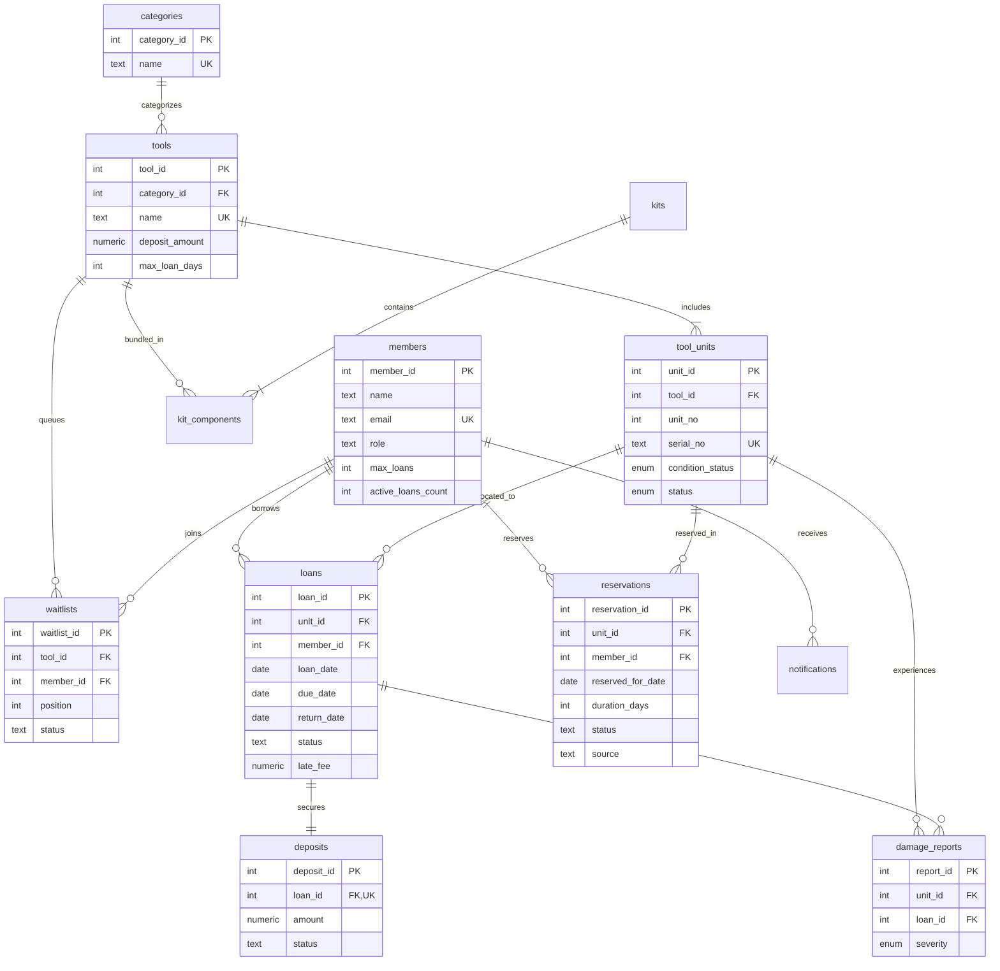

---

# 3. PostgreSQL Functions, Stored Procedures, Triggers, Constraints, and Views

### 3.1 Helper Functions

#### 1. `setting_int(k text) RETURNS int`
- Reads an integer parameter from the `settings` table safely.
- Used across procedures to get `deposit_hold_hours` (24h), `reservation_hold_hours` (48h), and `late_fee_per_day` (₹20).

#### 2. `notify(p_member int, p_msg text, p_kind text) RETURNS void`
- Inserts an in-app message into the `notifications` table for the target member.

#### 3. `fn_unit_free(p_unit int, p_from date, p_days int) RETURNS boolean`
- Evaluates whether a physical unit is available for a requested date range.
- Checks that the unit is not `'Repair'` or `'Retired'`, has no active overlapping reservations (`excl_no_overlap`), and has no open loans spanning into the requested window.

---

### 3.2 Database Triggers

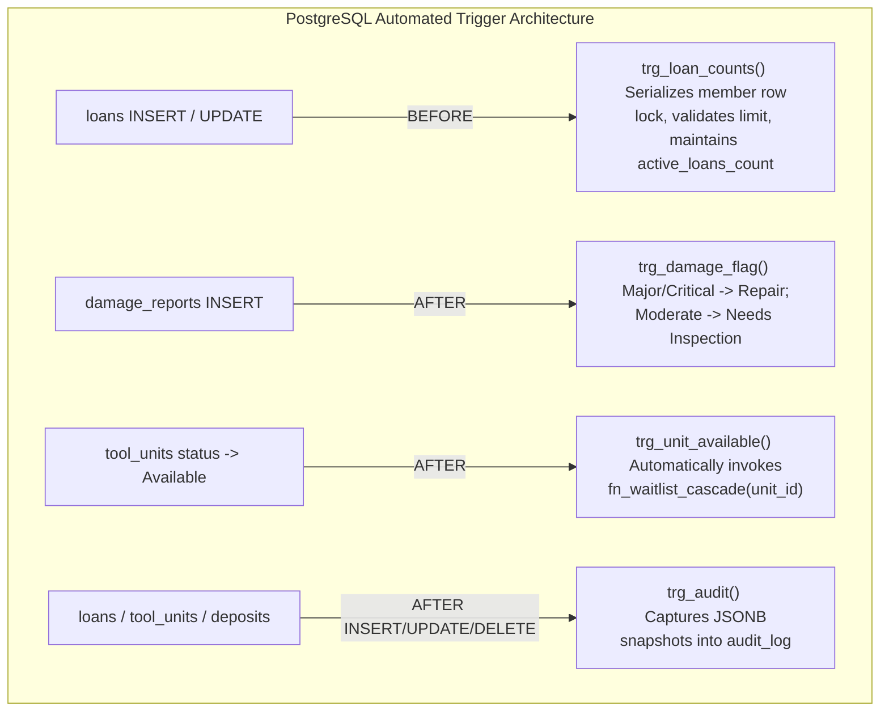

#### 1. `trg_loan_counts()`
- **Target Table:** `loans` (BEFORE INSERT OR UPDATE).
- **Behavior:**
  - On `INSERT`: Acquires an exclusive row lock on `members WHERE member_id = NEW.member_id FOR UPDATE`. Checks `m.active` (rejects inactive users). If `m.max_loans IS NOT NULL` and `active_loans_count >= max_loans`, raises exception `P0001: Loan limit reached`. Increments `active_loans_count` by 1.
  - On `UPDATE`: If `OLD.return_date IS NULL` and `NEW.return_date IS NOT NULL`, decrements `active_loans_count` by 1.

#### 2. `trg_damage_flag()`
- **Target Table:** `damage_reports` (AFTER INSERT).
- **Behavior:**
  - If `NEW.severity IN ('Major', 'Critical')`: Automatically transitions `tool_units` condition and status to `'Repair'`.
  - If `NEW.severity = 'Moderate'`: Sets condition to `'Needs Inspection'`.
  - Guarantees immediate quarantine without requiring manual staff status toggling.

#### 3. `trg_unit_available()` & `fn_waitlist_cascade(p_unit int)`
- **Target Table:** `tool_units` (AFTER UPDATE OF status).
- **Behavior:** Fires whenever a unit transitions into `'Available'`.
  - Checks if any member is in `waitlists WHERE tool_id = unit.tool_id AND status = 'Waiting'`.
  - Selects the head of the queue (`ORDER BY position LIMIT 1 FOR UPDATE SKIP LOCKED`).
  - Creates an active reservation for that member (`source = 'waitlist'`).
  - Sets `tool_units.status = 'Reserved'`.
  - Updates waitlist status to `'Promoted'` (`position = NULL`).
  - Decrements all subsequent waiting positions by 1 (`position = position - 1`).
  - Dispatches an automated notification: *"Good news! Equipment is now reserved for you."*

#### 4. `trg_audit()`
- **Target Tables:** `loans`, `tool_units`, `deposits` (AFTER INSERT OR UPDATE OR DELETE).
- **Behavior:** Appends an immutable audit record into `audit_log`, capturing JSONB snapshots of `OLD` and `NEW` records, the client user, and a timestamp.

---

### 3.3 Stored Procedures

| Procedure Name | Arguments | Purpose & Execution Flow | Concurrency & Safety Controls |
| :--- | :--- | :--- | :--- |
| **`sp_reserve`** | `p_member, p_tool, p_unit, p_from, p_days` | Validates dates and member loan limits. If a free unit exists, locks it with `FOR UPDATE SKIP LOCKED` and creates a reservation. If all units are busy, places the member at the tail of the waitlist queue. | Row lock on candidate unit; advisory lock on tool (`pg_advisory_xact_lock`) prevents waitlist position race conditions. |
| **`sp_reserve_kit`** | `p_kit, p_member, p_from, p_days` | Iterates over all kit components. Verifies that every single required tool has an available unit for the requested window. If all components are available, books them with `source = 'kit'`. If any component is unavailable, aborts with `P0002`. | Transactional atomicity: rollback guarantees zero partial reservations. |
| **`sp_checkout`** | `p_unit, p_member, p_days, p_res` | Handover procedure at the Staff Desk. Verifies unit availability and reservation matching. Creates loan record, updates unit status to `'Loaned'`, and creates `Held` deposit record. | Row locks unit and reservation; database trigger serializes member loan counter. |
| **`sp_checkout_kit`** | `p_kit, p_member, p_days` | Checks out all components of a kit in a single transactional loop. | All-or-nothing rollback if any unit is unavailable. |
| **`sp_checkin`** | `p_loan, p_severity, p_notes` | Equipment return processing. Marks loan `'Returned'`, calculates late fees (`days_late * ₹20`). If damage reported, logs `damage_reports` and quarantines to `'Repair'`. If returned clean, sets unit `'Available'`, immediately firing the waitlist cascade trigger. | Atomic return, condition update, and queue promotion in a single transaction. |
| **`sp_release_deposit`** | `p_loan` | Verifies that loan is returned, return window (24h) has elapsed, and no major damage is recorded. Updates deposit status to `'Released'`. Notifies member. | Re-verifies eligibility with row locks; idempotent (safe against double-clicks). |
| **`sp_forfeit_deposit`** | `p_loan` | Transitions deposit to `'Forfeited'` when severe damage or loss occurs. | Backend restricts execution to staff. |
| **`sp_complete_repair`** | `p_unit` | Completes repair bench work. Sets condition `'Good'` and status `'Available'`. Re-triggers waitlist cascade. | Checks unit is in `'Repair'` status. |
| **`sp_cancel_waitlist`** | `p_waitlist` | Cancels a waiting entry (`status = 'Cancelled'`, `position = NULL`) and shifts subsequent positions down. | Deferred unique constraint ensures seamless position shifting. |
| **`sp_promote_waitlist`**| `p_tool` | Validates that an available unit exists, then promotes the head of the waitlist queue into an active reservation. | Locks head of queue and available unit. |
| **`sp_expire_reservations`** | *none* | Maintenance job: marks uncollected reservations past `expires_at` as `'Expired'`. Frees unit back to `'Available'`. | `SKIP LOCKED` batch processing. |
| **`sp_mark_overdue`** | *none* | Maintenance job: flags loans where `due_date < current_date` as `'Overdue'`. | Batch status transition. |

---

### 3.4 Database Views

1. **`v_tool_availability`**: Aggregates total, available, loaned, reserved, and repair unit counts per tool model alongside waitlist queue length.
2. **`v_kit_availability`**: Evaluates whether all component tools of a kit have at least one available unit; reports blocking tools when unavailable.
3. **`v_fleet_status`**: Category-level inventory rollups used by the dashboard fleet composition widget.
4. **`v_deposit_holds`**: Feeds the Staff Desk Deposit Management table. Exposes `loan_id`, `member`, `tool`, `amount`, `status`, `expected_return_date` (`due_date`), `actual_return_date` (`return_date`), `releasable` boolean, and `has_damage`.
5. **`v_waitlist_by_tool`**: Summarizes waitlist counts and longest wait timestamps per equipment model.
6. **`v_loan_duration_by_category`**: Computes average days borrowed and percentage of late returns per category.
7. **`v_overdue_loans`**: Pinpoints active overdue loans, days delinquent, and accrued late penalties.
8. **`v_tool_utilisation`**: Ranks tools by lifetime loan frequency and calculated utilization rates.

---

### 3.5 Architectural Separation of Responsibilities

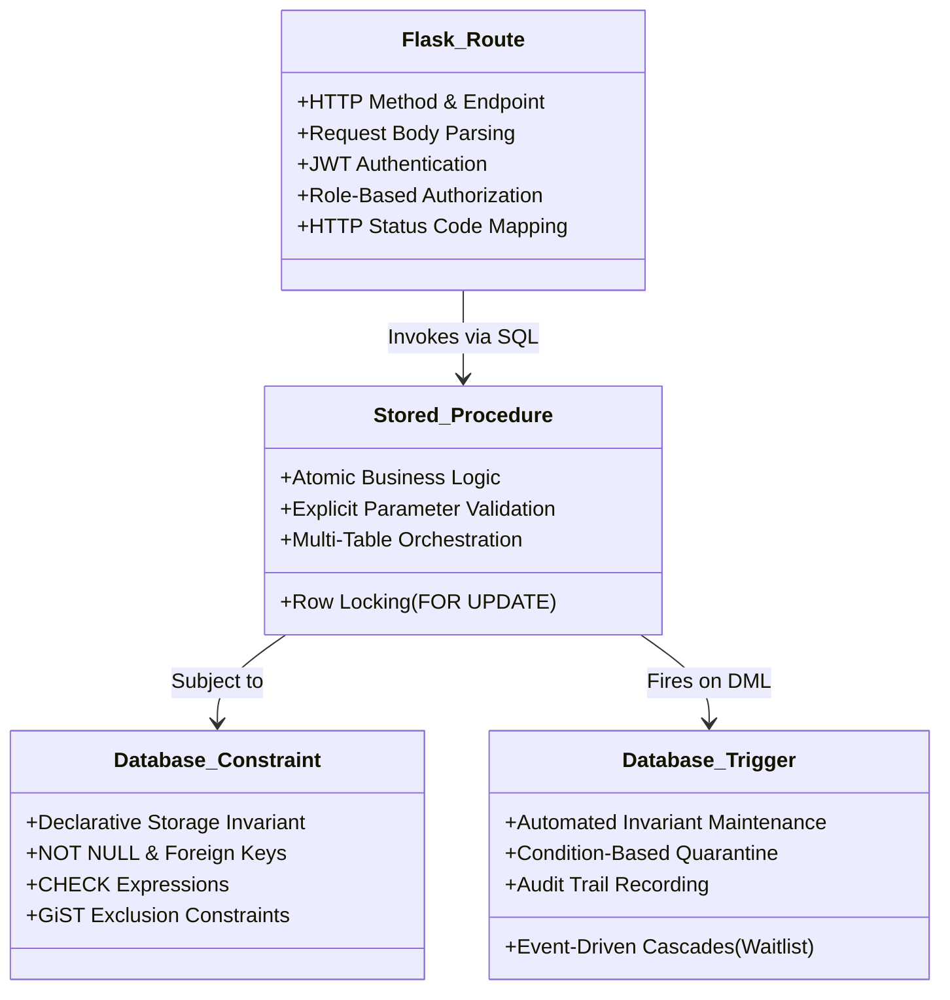

- **Flask Routes:** Handle HTTP transport, parse JSON, verify JWT tokens, enforce role gates, and return JSON responses. Flask **never** contains direct business algorithms like waitlist promotion or deposit hold math.
- **Stored Procedures:** Perform complete business operations (e.g., checkout, return, kit reservation) inside single transactional boundaries.
- **Database Triggers:** Guarantee data integrity automatically regardless of which client, script, or route touches the data.
- **Database Constraints:** The ultimate backstop. Even if a bug existed in Python or PL/pgSQL, PostgreSQL's storage engine physically prevents invalid data states (such as overlapping bookings or negative deposits).

---

# 4. Exact End-to-End Workflows

### Workflow A: User Registration
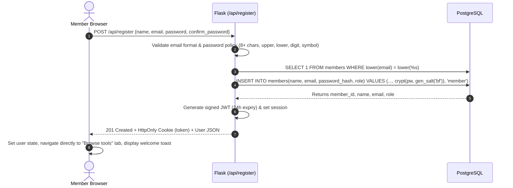
- **Page & Controls:** Registration Form (`#auth-panel`).
- **Client Handler:** `handleRegister()` in [`app/static/index.html`](file:///c:/Users/tanvi/Downloads/Library_of_Things/app/static/index.html#L756-L777).
- **Backend Endpoint:** `POST /api/register` in [`app/app.py`](file:///c:/Users/tanvi/Downloads/Library_of_Things/app/app.py#L141-L191).
- **Database Interaction:** Inserts into `members` with `crypt(pw, gen_salt('bf'))`. Public registration forces `role = 'member'`.
- **Immediate Outcome:** The user is **automatically authenticated** on both the frontend and backend without a redundant second login. The user lands on **Browse tools** with an active session cookie and welcoming toast.

---

### Workflow B: Login, Authentication & Role Isolation
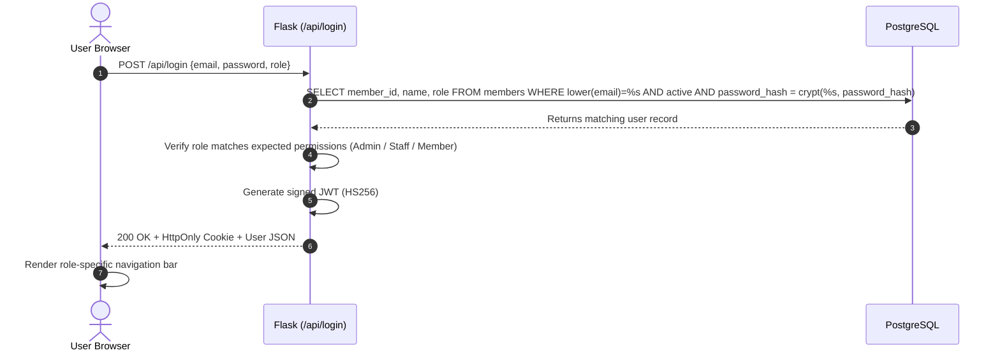
- **Role Isolation:**
  - **Members** see: `Browse tools`, `Kits`, `My account`.
  - **Administrators** see **strictly three tabs**: `Staff desk`, `Dashboard`, `Concurrency lab`.
  - **Backend Enforcement:** Calling `/api/my`, `/api/reserve`, or `/api/kits/<id>/reserve` with an administrator token returns `403 Forbidden: Administrative role detected. Member tabs and self-service bookings are reserved for member accounts.` Calling staff routes with a member token returns `403 Forbidden: Staff only`.

---

### Workflow C: Equipment Catalogue & Availability Discovery
- **Page:** `Browse tools` (`tab = 'browse'`).
- **Client Handler:** `loadTools()` calls `GET /api/tools?q=&category=`.
- **Backend Endpoint:** `GET /api/tools` queries view `v_tool_availability`.
- **UI Presentation:** Each tool card displays:
  - Tool name, category, deposit amount (e.g. ₹1,500), and max borrowing days.
  - Live availability badge: `[X available]` (green) or `[all out]` (red).
  - Physical breakdown bar: available (green), reserved (blue), loaned (orange), repair (red).
  - Waitlist indicator: displays bold waiting count (e.g., `3 waiting`) when units are scarce.
  - Interactive Action: If units available → **Reserve**; if all units out → **Join waitlist**.

---

### Workflow D: Single Equipment Reservation & Overlap Prevention
- **Page & Button:** Click **Reserve** on any tool card → opens `reserveDlg(toolId)`.
- **Client Handler:** `doReserve()` calls `POST /api/reserve` with `{tool_id, date, days, unit_id}`.
- **Backend Endpoint:** Calls `sp_reserve(member_id, tool_id, unit_id, date, days)`.
- **Database Logic:**
  1. Verifies member is active and borrowing days do not exceed `tools.max_loan_days`.
  2. Evaluates member loan limits (`max_loans`).
  3. Searches for a free physical unit using `fn_unit_free()` and locks it with `FOR UPDATE SKIP LOCKED`.
  4. If a unit is free: Inserts into `reservations` (`source = 'direct'`). The GiST exclusion constraint `excl_no_overlap` guarantees zero date conflicts.
  5. If no units are free: Acquires an advisory lock (`pg_advisory_xact_lock(tool_id)`), computes next FIFO position (`COALESCE(max(position),0)+1`), inserts into `waitlists`, and returns outcome `'waitlisted'`.
- **User Feedback:** Green toast confirms *"Reserved successfully! Reservation #..."* or *"Added to waitlist at position #..."*.

---

### Workflow E: Administrator Equipment Handover (Checkout)
```mermaid
sequenceDiagram
    autonumber
    actor Admin as Staff / Admin
    participant App as Flask (/api/staff/checkout)
    participant DB as PostgreSQL (sp_checkout)
    participant Trg as Trigger: trg_loan_counts

    Admin->>App: POST /api/staff/checkout {unit_id, member_id, days, reservation_id}
    App->>DB: SELECT sp_checkout(unit_id, member_id, days, reservation_id)
    DB->>DB: Lock unit FOR UPDATE; verify status <> 'Loaned' / 'Repair'
    DB->>DB: If reservation_id present: verify match, update status = 'Fulfilled'
    DB->>DB: INSERT INTO loans(unit_id, member_id, loan_date, due_date)
    DB->>Trg: BEFORE INSERT on loans fires
    Trg->>DB: Lock member row FOR UPDATE; verify active; increment active_loans_count
    DB->>DB: UPDATE tool_units SET status = 'Loaned'
    DB->>DB: INSERT INTO deposits(loan_id, amount, status) VALUES (lid, deposit_amount, 'Held')
    DB-->>App: Returns loan_id
    App-->>Admin: 200 OK {loan_id: 101}
    Admin->>Admin: Toast "Equipment handed over", refresh Staff Desk tables
```
- **Concrete Example:**
  - *Before:* Reservation #42 is `'Active'` for Drill Unit #1. `tool_units` status is `'Reserved'`. Member active loans = 1.
  - *Handover executed:* Reservation #42 becomes `'Fulfilled'`. Loan #101 created (due date = today + 3 days). Deposit #101 created for ₹1,500 (`status = 'Held'`). `tool_units` status becomes `'Loaned'`. Member active loans increments to 2.
  - *After:* Loan moves to **Active loans & returns** table; reservation disappears from **Pending Reservations**.

---

### Workflow F: Equipment Return & Automated Waitlist Cascade
```mermaid
sequenceDiagram
    autonumber
    actor Admin as Staff / Admin
    participant App as Flask (/api/staff/checkin)
    participant DB as PostgreSQL (sp_checkin)
    participant Trg1 as Trigger: loan_counts
    participant Trg2 as Trigger: damage_flag
    participant Trg3 as Trigger: unit_available -> fn_waitlist_cascade

    Admin->>App: POST /api/staff/checkin {loan_id: 101, severity: null, notes: ''}
    App->>DB: SELECT sp_checkin(101, NULL, '')
    DB->>DB: Lock loan FOR UPDATE; verify return_date IS NULL
    DB->>DB: Calculate late fee: max(0, return_date - due_date) * 20
    DB->>DB: UPDATE loans SET return_date = current_date, status = 'Returned', late_fee = fee
    DB->>Trg1: Decrement member active_loans_count by 1
    alt Clean Return (Good Condition)
        DB->>DB: UPDATE tool_units SET status = 'Available'
        DB->>Trg3: Unit is Available -> fn_waitlist_cascade fires!
        Trg3->>DB: Lock waitlist head FOR UPDATE SKIP LOCKED
        Trg3->>DB: INSERT INTO reservations(source='waitlist', status='Active', expires_at=now()+48h)
        Trg3->>DB: UPDATE tool_units SET status = 'Reserved'
        Trg3->>DB: UPDATE waitlists SET status = 'Promoted', position = NULL
        Trg3->>DB: Shift remaining queue positions (position = position - 1)
        Trg3->>DB: PERFORM notify(promoted_member, 'Equipment reserved for you', 'waitlist')
    else Damaged Return (Major/Critical)
        DB->>DB: INSERT INTO damage_reports(unit_id, loan_id, severity, description)
        DB->>Trg2: Automatically sets unit status = 'Repair' (Quarantined!)
        Note over DB,Trg3: Waitlist cascade is NOT fired; unit stays off shelf
    end
    DB-->>App: Returns {late_fee, unit_state, promoted: {name, tool, unit_no}}
    App-->>Admin: 200 OK + Promoted notification
```

---

### Workflow G: Deposit Management & Dashboard Financial Accounting
- **Location:** Admin → **Staff desk** → **Deposit management**.
- **9 Explicit Lifecycle Columns:**
  1. `Loan ID` (e.g., `#101`)
  2. `Member name` (e.g., `Sarah Connor`)
  3. `Equipment name` (e.g., `4-Person Tent`)
  4. `Deposit amount` (e.g., `₹2,500`)
  5. `Expected return date` (e.g., `2026-10-28`)
  6. `Actual return date` (`—` if not returned, or `2026-10-25` when returned)
  7. `Return status` (`Not Returned` [orange] or `Returned` [green])
  8. `Deposit status` (`Not returned`, `Awaiting inspection`, `Damage hold`, `Ready to release`, `Released`)
  9. `Action` (Active **Release Deposit** button, or disabled badge explaining current hold)
- **Financial Accounting Invariants:**
  - **Deposits Held KPI:** `SELECT coalesce(sum(amount),0) FROM deposits WHERE status='Held'`
  - **Deposits Released KPI:** `SELECT coalesce(sum(amount),0) FROM deposits WHERE status='Released'`
  - Releasing a ₹2,500 deposit decrements `held` by exactly ₹2,500 and increments `released` by ₹2,500. Money held and money refunded are never combined or double-counted.
  - **Forfeit Button:** Completely removed from all UI tables and backend endpoints.

---

### Workflow H: Waitlist Administration, FIFO Ordering & Promotions
- **Location:** Admin → **Staff desk** → **Waitlist management**.
- **Lifecycle Transparency:**
  - Displays selected equipment fleet statistics (total units, available, loaned, in repair).
  - **Active Loans Table:** Identifies who currently possesses units, when borrowed, and expected due dates.
  - **FIFO Queue Table:** Lists waiting members in strict order (`Queue #1`, `Queue #2`), email, waitlist request date, and allocation status.
  - **Administrative Actions:**
    - **Cancel entry:** Invokes `sp_cancel_waitlist(waitlist_id)`. Updates status to `'Cancelled'` and shifts all subsequent positions forward (`#3` becomes `#2`).
    - **Promote head:** Invokes `sp_promote_waitlist(tool_id)`. If an available unit exists, allocates it to Queue Position #1 immediately.
  - **Promotion Audit Log:** Bottom table records recent promotions, allocated unit numbers, and 48-hour collection hold expiry deadlines.

---

### Workflow I: Equipment Kits (Multi-Component Atomic Reservations)
- **Database Model:** `kits` (e.g., *Camp Kit*) linked to `kit_components` (references *4-Person Tent* + *Camping Stove*).
- **Interactive UI:** Kits tab displays clean status badges:
  - **Available** (green): All component tools have at least one free unit.
  - **Unavailable** (gray): One or more components are out. Clearly explains blocking items (e.g., *"Currently unavailable because Camping Stove is on loan"*).
- **Atomic Multi-Component Reservation (`sp_reserve_kit`):**
  - Iterates over all components in a single transaction.
  - Locks available units using `FOR UPDATE SKIP LOCKED`.
  - If any component is unavailable: Raises exception `P0002`, triggering an **immediate atomic rollback**. Zero partial reservations are created.
  - If all components are available: Creates reservations with `source = 'kit'`, appearing under the member's account.

---

### Workflow J: Staff Desk Operations

The Staff Desk is structured into 5 streamlined operational workflows:
1. **Reservations & handover:** Lists pending reservations ready for collection. Clicking **Hand over equipment** issues the physical loan. Contains an integrated walk-in loan checkout form.
2. **Active loans & returns:** Displays all equipment currently out in the community, borrower contact details, and overdue counters. Clicking **Process return…** opens the condition inspection dialog.
3. **Deposit management:** Transparent 9-column deposit custody table with one-click release for eligible items.
4. **Waitlist management:** Complete FIFO queue tracking, active loan due date monitoring, manual promotions, and cancellations.
5. **Repair bench:** Quarantined equipment list. Clicking **Repair complete** calls `sp_complete_repair()`, restoring the unit to `'Available'` and automatically checking the waitlist cascade.

---

### Workflow K: Damage Reporting & Repair Bench Quarantine
- When returning an item in `checkinDlg`, staff selects return severity:
  - `No damage (Good condition)` → unit returns to shelf.
  - `Minor cosmetic wear` → logged for records; unit remains available.
  - `Moderate wear / needs inspection` → condition becomes `'Needs Inspection'`.
  - `Major damage` or `Critical failure` → unit condition and status become `'Repair'`.
- Database constraint `chk_repair_not_offered` ensures that a unit in `'Repair'` condition can **never** be booked.
- The unit is quarantined on the **Repair bench** tab until an administrator clicks **Repair complete**, restoring it to circulation.

---

### Workflow L: Dashboard & Analytics Engine
The Dashboard queries 8 specialized views and computes live KPIs:
- **KPI Grid (5 Metrics):**
  - `physical units`: Total units owned across all tools (`SELECT count(*) FROM tool_units`).
  - `active members`: Registered member count (`SELECT count(*) FROM members WHERE role='member'`).
  - `loans recorded`: Lifetime borrowings completed (`SELECT count(*) FROM loans`).
  - `deposits held`: Outstanding caution deposits currently held (`SELECT sum(amount) FROM deposits WHERE status='Held'`).
  - `deposits released`: Total caution deposits refunded (`SELECT sum(amount) FROM deposits WHERE status='Released'`).
- **Fleet Status by Category (`v_fleet_status`):** Visual distribution of available, reserved, loaned, and repair units.
- **Deposit Activity (`v_deposit_holds`):** Recent deposit status transitions.
- **Most-Used Equipment (`v_tool_utilisation`):** Lifetime loan frequency per equipment model.
- **Borrowing Durations (`v_loan_duration_by_category`):** Average days kept and delinquency percentages.
- **System Audit Trail:** Real-time log of database mutations from `audit_log`.

---

### Workflow M: Concurrency Laboratory & Race Condition Defense
Accessible to administrators at **Concurrency lab** (`/api/lab/run`). Demonstrates multi-threaded race conditions by launching parallel threads attempting to reserve the exact same physical unit for identical dates:

1. **Unprotected (`unprotected`):** Simple `SELECT` followed by `INSERT` without locking. Consistently demonstrates **double-booking anomalies** (overselling inventory).
2. **Row Locking (`for_update`):** Executes `SELECT ... FOR UPDATE`. Forces competing transactions to queue sequentially, rejecting the second contender.
3. **Exclusion Constraint (`exclusion_constraint`):** Relies on PostgreSQL's GiST index constraint `excl_no_overlap`. The database kernel rejects the overlapping insert with error code `23P01`.
4. **Serializable Isolation (`serializable`):** Runs transactions under `SET TRANSACTION ISOLATION LEVEL SERIALIZABLE`. PostgreSQL aborts concurrent overlapping transactions with serialization failure (`40001`).

---

### Workflow N: Member Account Center, Notifications & Borrowing History
- **Location:** Member navigation → **My account** (`/api/my`).
- **Displays:**
  - **In-App Notifications:** Alerts for waitlist promotions and released deposits. Button to **Mark notifications read**.
  - **Active Waitlist Tickets:** Tool name, status (`Waiting`), and current queue position (e.g. `position #1`).
  - **Active Reservations:** Tool, unit number, reservation dates, duration, hold expiry, and source badge (`waitlist`, `kit`, or `direct`). Includes button to cancel active bookings.
  - **Borrowing History:** Table of past and current loans, borrowed dates, due dates, return dates, late fees, and deposit status.

---

# 5. Business Rules and State Transitions

### 5.1 Physical Units Lifecycle
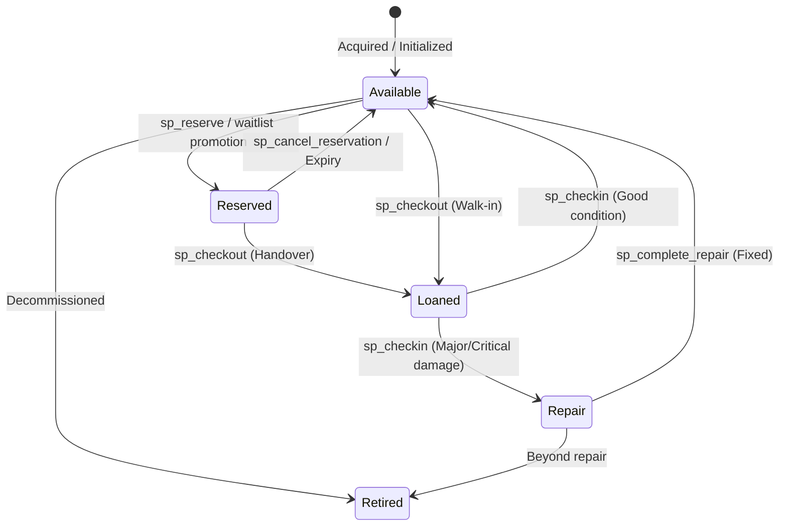

---

### 5.2 Reservations Lifecycle
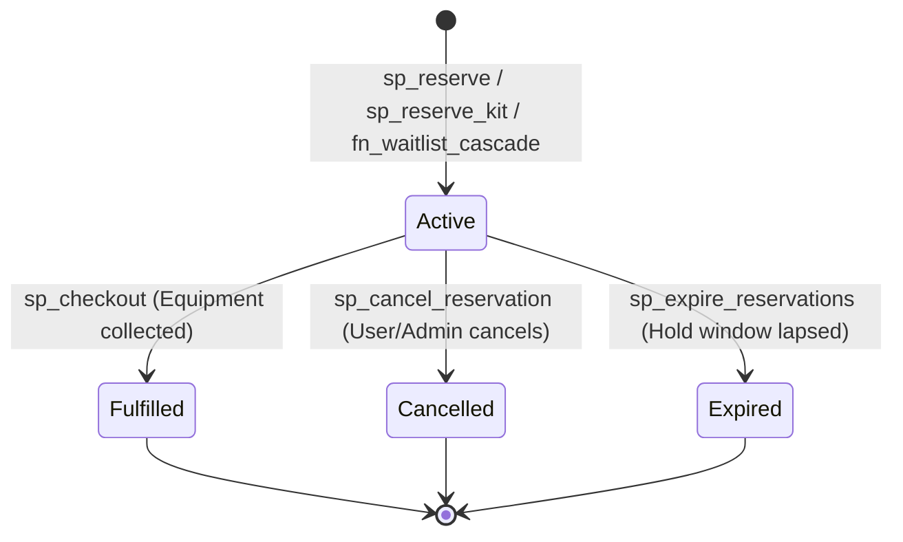

---

### 5.3 Loans Lifecycle
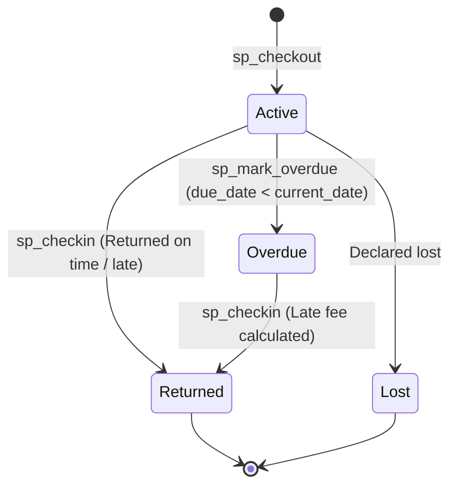

---

### 5.4 Deposits Lifecycle
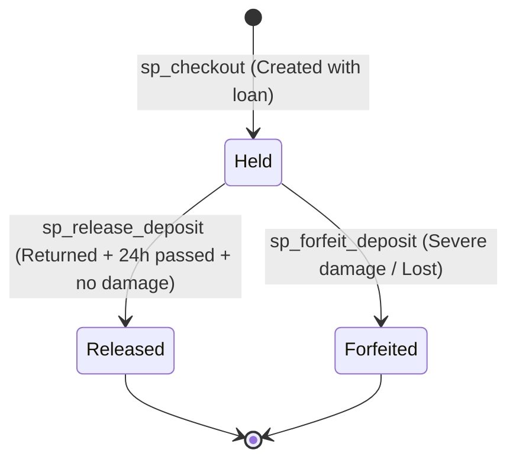

---

### 5.5 Waitlist Queue Lifecycle
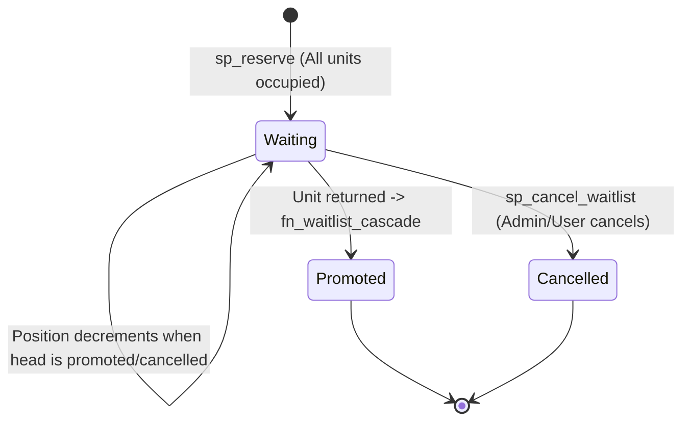

---

# 6. Security, Integrity, and Error Handling

### 6.1 Password Security & Policies
- Passwords are never stored in plaintext. They are encrypted using database-native bcrypt via `pgcrypto`:
  ```sql
  password_hash = crypt(password, gen_salt('bf', 10))
  ```
- **Password Policy Enforced in [`validate_password_policy()`](file:///c:/Users/tanvi/Downloads/Library_of_Things/app/app.py#L127-L139):**
  - Minimum 8 characters.
  - At least one numeric digit (`0-9`).
  - At least one uppercase letter (`A-Z`).
  - At least one lowercase letter (`a-z`).
  - At least one special character (`[!@#$%^&*(),.?":{}|<>]`).

### 6.2 JWT Tokens & Session Security
- Generated using `PyJWT` with HMAC-SHA256 (`HS256`).
- Payload contains `sub` (member_id), `name`, `role`, `iat` (issued at), and `exp` (24-hour expiration).
- Transported via both `Authorization: Bearer <token>` and **HttpOnly Cookies**:
  - `httponly=True`: Prevents client-side JavaScript access (mitigates XSS token theft).
  - `samesite="Lax"`: Prevents CSRF attacks during cross-site requests.
  - `path="/"`: Scoped across the entire application.

### 6.3 Role-Based Access Control (RBAC) & Route Isolation
- Three recognized roles: `'admin'`, `'staff'`, `'member'`.
- **Public Registration:** Hardcoded to assign `role = 'member'`. Any attempt to supply an administrative role in public registration payload is rejected with `403 Forbidden`.
- **Administrative Isolation:** Backend route protection explicitly bars administrators from self-service member booking routes (`/api/my`, `/api/reserve`, `/api/kits/<id>/reserve`).

### 6.4 Row-Level Security (RLS) in PostgreSQL
PostgreSQL enforces row-level security on `loans`, `reservations`, `waitlists`, `notifications`, and `deposits`:
- **Staff Policy:** `CREATE POLICY staff_all ON ... TO circulend_staff USING (true);`
- **Member Policy:** `CREATE POLICY own_rows ON ... TO circulend_member USING (member_id = nullif(current_setting('app.member_id', true),'')::int);`
- When Flask runs a query inside `tx()`, it sets `SET LOCAL ROLE circulend_member` and `SELECT set_config('app.member_id', %s, true)`. Even if an attacker modified the SQL query, PostgreSQL's kernel suppresses rows belonging to other members.

### 6.5 SQL Injection Defense & Parameterization
- 100% of SQL queries across the application use parameterized placeholders (`%s`) via `psycopg2`.
- Zero dynamic SQL string formatting (`f"SELECT ... {input}"`) is used for user data.

### 6.6 Exclusion Constraints & GiST Indexing
- The PostgreSQL `btree_gist` extension enables multidimensional range indexing.
- `excl_no_overlap` on `reservations` treats each booking as a spatio-temporal box: `(unit_id, [start, start + duration])`. If two ranges overlap (`&&`) on the same unit (`=`), PostgreSQL physically rejects the insert at the index level.

### 6.7 Transaction Isolation & Concurrency Control
- Standard application queries run under PostgreSQL's default `READ COMMITTED` isolation level with explicit pessimistic locking (`FOR UPDATE` / `SKIP LOCKED`).
- `FOR UPDATE SKIP LOCKED` allows high-concurrency reservation processing: competing transactions skip rows already locked by other threads, booking different units without thread blocking.

### 6.8 PostgreSQL Error Codes & Exception Mapping

In [`app/app.py`](file:///c:/Users/tanvi/Downloads/Library_of_Things/app/app.py#L31-L39), PostgreSQL error codes are translated into meaningful HTTP responses:

| PostgreSQL Error Code | Standard SQL Name | CircuLend Business Meaning | Translated HTTP Status |
| :--- | :--- | :--- | :--- |
| **`23P01`** | `exclusion_violation` | Overlapping reservation dates on the requested unit | `409 Conflict` |
| **`23505`** | `unique_violation` | Duplicate email or duplicate open loan on unit | `409 Conflict` |
| **`42501`** | `insufficient_privilege` | RLS or role permission check failed | `403 Forbidden` |
| **`40001`** | `serialization_failure` | Concurrent transaction conflict in serializable mode | `409 Conflict` |
| **`P0001`** | `raise_exception` | Custom business rule violation (e.g. loan limit reached) | `400 Bad Request` |
| **`P0002`** | `raise_exception` | Atomic kit booking failure (missing component) | `409 Conflict` |
| **`23514`** | `check_violation` | Invalid dates, negative fees, or damaged unit offered | `400 Bad Request` |
| **`23503`** | `foreign_key_violation`| Referenced tool, unit, or member does not exist | `400 Bad Request` |

---

# 7. Demo Database and Seed Data

### 7.1 Database Initialization Sequence
The PostgreSQL engine must be initialized in this exact file sequence:
1. **`db/01_schema.sql`**: Installs `pgcrypto` and `btree_gist`, drops/recreates `public` schema, creates ENUMs, and defines all 13 tables, primary keys, foreign keys, check constraints, and indexes.
2. **`db/02_logic.sql`**: Compiles PL/pgSQL helper functions, database triggers, stored procedures, and analytics views.
3. **`db/03_security.sql`**: Configures database roles (`circulend_staff`, `circulend_member`), grants object-level privileges, and enables Row-Level Security policies.

---

### 7.2 Seed Data Breakdown
The seeder script [`db/seed.py`](file:///c:/Users/tanvi/Downloads/Library_of_Things/db/seed.py) creates a rich, realistic community dataset:
- Sets `session_replication_role = replica` to allow high-speed historical bulk-loading without triggering business triggers.
- Populates:
  - **4 Categories:** Power Tools, Gardening, Cleaning, Camping.
  - **33 Tools:** e.g., Bosch Combi Drill, Pressure Washer, Carpet Shampooer, 4-Person Tent, Tile Cutter.
  - **80 Physical Units:** Each with unique serial numbers, acquisition dates, and condition states.
  - **50 Members:** Realistic Indian names, emails, contact numbers, and default `max_loans = NULL`.
  - **2 Kits:** *Camp Kit* (Tent + Stove), *Reno Kit* (Drill + Jigsaw).
  - **Historical Activity:** 35 completed historical loans, 3 active open loans, 3 waitlist entries for high-demand tools, and future reservations.

---

### 7.3 Built-in Demo Accounts

> [!NOTE]
> All demonstration accounts share the local password: `circulend123` (or `pw` in test fixtures).

| Role | Account Name | Email Address | Access Level |
| :--- | :--- | :--- | :--- |
| **Administrator** | Admin User | `admin@circulend.in` | Staff Desk, Dashboard, Concurrency Lab, Database Reset |
| **Staff Member** | Staff Meena | `staff.meena@circulend.in` | Staff Desk, Handover, Returns, Deposit Release, Repair |
| **Staff Member** | Staff Ravi | `staff.ravi@circulend.in` | Staff Desk, Handover, Returns, Deposit Release, Repair |
| **Community Member**| Sarah Connor | `sarah.connor@example.in` | Tool Browsing, Kit Reservations, Account Center |
| **Restricted Member**| Dan (Test Fixture)| `dan@t.in` | Custom limit of 2 items (`max_loans = 2`) for testing |

---

### 7.4 Safe Database Inspection & Reset Procedures
- **Safe Reset:** An administrator can re-seed the demonstration database at any time by calling `POST /api/admin/reset-demo` or running:
  ```powershell
  python db/seed.py
  ```
- **Inspect Running Container:**
  ```powershell
  docker exec -it library_of_things_db psql -U circulend -d circulend
  ```

---

# 8. Beginner-Friendly SQL Examples

All queries below are strictly read-only (`SELECT`) and safe to execute in `psql` or pgAdmin:

### Query 1: List all database tables and comment types
```sql
SELECT table_name, table_type 
FROM information_schema.tables 
WHERE table_schema = 'public' 
ORDER BY table_name;
```

### Query 2: Inspect physical equipment units and live condition
```sql
SELECT u.unit_id, t.name AS equipment_name, u.unit_no, u.serial_no, 
       u.condition_status, u.status 
FROM tool_units u 
JOIN tools t USING (tool_id) 
ORDER BY t.name, u.unit_no;
```

### Query 3: View all active (unreturned) equipment loans
```sql
SELECT l.loan_id, m.name AS borrower, t.name AS equipment, u.unit_no, 
       l.loan_date, l.due_date, 
       CURRENT_DATE - l.due_date AS days_overdue
FROM loans l
JOIN members m USING (member_id)
JOIN tool_units u USING (unit_id)
JOIN tools t USING (tool_id)
WHERE l.return_date IS NULL
ORDER BY l.due_date ASC;
```

### Query 4: Inspect active reservations and collection hold deadlines
```sql
SELECT r.reservation_id, m.name AS member, t.name AS equipment, 
       u.unit_no, r.reserved_for_date, r.duration_days, 
       r.expires_at, r.source
FROM reservations r
JOIN members m USING (member_id)
JOIN tool_units u USING (unit_id)
JOIN tools t USING (tool_id)
WHERE r.status = 'Active'
ORDER BY r.reserved_for_date ASC;
```

### Query 5: Inspect caution deposit custody (Held vs. Released)
```sql
SELECT d.deposit_id, l.loan_id, m.name AS member, t.name AS equipment, 
       d.amount, d.status, l.return_date
FROM deposits d
JOIN loans l USING (loan_id)
JOIN members m USING (member_id)
JOIN tool_units u USING (unit_id)
JOIN tools t USING (tool_id)
ORDER BY d.deposit_id DESC;
```

### Query 6: Inspect waitlist queues in strict FIFO order
```sql
SELECT w.waitlist_id, t.name AS equipment, w.position, 
       m.name AS waiting_member, m.email, w.requested_at, w.status
FROM waitlists w
JOIN tools t USING (tool_id)
JOIN members m USING (member_id)
WHERE w.status = 'Waiting'
ORDER BY t.name, w.position ASC;
```

### Query 7: Check kit bundled components
```sql
SELECT k.name AS kit_name, t.name AS component_tool, t.deposit_amount
FROM kits k
JOIN kit_components kc USING (kit_id)
JOIN tools t USING (tool_id)
ORDER BY k.name, t.name;
```

### Query 8: Read latest immutable audit-log events
```sql
SELECT audit_id, table_name, row_id, action, changed_at, db_user, new_data
FROM audit_log
ORDER BY audit_id DESC
LIMIT 10;
```

---

# 9. Troubleshooting Guide

| Issue | Root Cause | Where to Look / How to Fix |
| :--- | :--- | :--- |
| **Database Connection Refused (`5432`)** | Docker container is stopped or port `5432` is occupied by another service. | Run `docker ps`. If stopped, run `docker compose up -d`. If another Postgres server is bound, stop it with `net stop postgresql` or change port mapping. |
| **`Loan limit reached (X of Y items)`** | Member has reached their account-specific borrowing cap (`members.max_loans`). | Check `SELECT max_loans, active_loans_count FROM members WHERE member_id = ...`. If artificial cap, set `max_loans = NULL`. |
| **`Cannot release: return window open`** | 24-hour mandatory holding period has not yet elapsed since return. | Check `v_deposit_holds`. In demo/testing, backdate return date: `UPDATE loans SET return_date = current_date - 2 WHERE loan_id = ...`. |
| **`Cannot release: return-condition check failed`** | Item was returned with moderate or major damage (`damage_reports`). | Check `SELECT * FROM damage_reports WHERE loan_id = ...`. Deposit is held for repair compensation. |
| **Waitlist cascade did not promote member** | Item was returned damaged, so unit transitioned to `'Repair'` rather than `'Available'`. | Check `tool_units.status`. Unit must be repaired and cleared via `sp_complete_repair` before waitlist cascade triggers. |
| **`That unit is already booked for those dates` (`23P01`)** | PostgreSQL `excl_no_overlap` GiST exclusion constraint blocked date collision. | Expected security behavior. Choose a different date range or a different physical unit. |
| **Kit reservation rejected with `P0002`** | At least one required component tool in the kit has zero available physical units. | Check `v_kit_availability`. All components must have free units for atomic kit booking. |
| **Admin cannot access member tabs (`403 Forbidden`)** | Intentional architectural role isolation preventing administrators from borrowing tools. | Log out and sign in using a regular community member account (`role = 'member'`). |

---

# 10. Teacher / Viva Preparation

### 10.1 System Elevator Pitch
> *"CircuLend is a full-stack, circular-economy tool-lending platform engineered with Python Flask and PostgreSQL 16. Unlike standard CRUD applications where business logic lives in easily bypassed application code, CircuLend enforces enterprise data integrity directly inside the database kernel. It features mathematical exclusion constraints to eliminate double-booking, PL/pgSQL triggers that automatically promote FIFO waitlist queues when equipment is returned, automatic condition-based repair quarantines, and strict Row-Level Security."*

---

### 10.2 Core Database Concepts Demonstrated

1. **Third Normal Form (3NF) & Schema Normalization:** Tables are decomposed to eliminate update, insertion, and deletion anomalies.
2. **Controlled Denormalization:** `members.active_loans_count` is stored for $O(1)$ loan checks, but maintained exclusively by trigger `trg_loan_counts`.
3. **Surrogate Keys vs. Business Candidate Keys:** `tool_units` uses surrogate `unit_id` with composite unique constraint `(tool_id, unit_no)`.
4. **Custom Enumerations (`CREATE TYPE ... AS ENUM`):** Enforces strict state vocabularies (`unit_status`, `condition_state`, `severity_level`).
5. **Generalized Search Tree (GiST) & Range Types:** Utilizes `daterange` and `btree_gist` to implement exclusion constraints (`&&`).
6. **Pessimistic Concurrency Control:** `FOR UPDATE` and `SKIP LOCKED` prevent race conditions during high-volume bookings.
7. **Advisory Locks (`pg_advisory_xact_lock`):** Application-level transactional locks in PostgreSQL preventing queue number collisions.
8. **Automated Event Triggers:** Pre- and post-DML hooks executing cascades (`AFTER UPDATE OF status`).
9. **Row-Level Security (RLS):** Database policies (`USING (member_id = ...)`) restricting data visibility at the storage engine level.
10. **Database Views:** Decouples reporting analytics from underlying physical table structures.
11. **Immutable Audit Trails:** Captures historical JSONB diffs of deleted and updated rows.
12. **ACID Transactional Atomicity:** Guarantees all-or-nothing multi-component kit reservations (`sp_reserve_kit`).
13. **Cryptographic Hashing:** Uses `pgcrypto` Blowfish hashing directly inside database inserts.
14. **Deferrable Constraints:** `DEFERRABLE INITIALLY DEFERRED` enables shifting waitlist positions without constraint violations.
15. **Partial Secondary Indexes:** Filtered indexes (`WHERE return_date IS NULL`) optimizing targeted operational access paths.

---

### 10.3 28 Likely Viva Questions & Codebase Answers

#### Q1: What happens if two members click "Reserve" on the last available drill at the exact same millisecond?
> **Answer:** CircuLend implements two lines of defense. First, `sp_reserve` executes `SELECT ... FOR UPDATE SKIP LOCKED`. The first transaction acquires a row-level lock on the unit. The second transaction skips that locked unit, finds no free units, and places the member on the waitlist. Second, even if application code failed, PostgreSQL's GiST exclusion constraint `excl_no_overlap` rejects overlapping date ranges with error code `23P01`.

#### Q2: What is the difference between `tools` and `tool_units`?
> **Answer:** `tools` is the abstract catalog specification (e.g., Bosch Combi Drill, ₹1,500 deposit), while `tool_units` represents the individual physical inventory assets (Unit #1 with serial `SN-01`, Unit #2 with serial `SN-02`). Each physical unit independently tracks its own condition and status.

#### Q3: Why is `active_loans_count` stored on the `members` table if it can be calculated with `COUNT(*)`?
> **Answer:** It is a controlled denormalization. Calculating `COUNT(*)` on large loan tables during every checkout is an $O(N)$ table scan. By storing `active_loans_count`, checking loan limits is an $O(1)$ operation. Data integrity is guaranteed because this column can **only** be modified by the database trigger `trg_loan_counts()`.

#### Q4: How does the system ensure that a damaged tool is not rented out?
> **Answer:** At the table level, constraint `chk_repair_not_offered` enforces `CHECK (NOT (condition_status = 'Repair' AND status IN ('Available','Reserved')))`. When a tool is checked in with major damage, trigger `trg_damage_flag()` automatically sets the status to `'Repair'`, which prevents `fn_unit_free()` from offering it.

#### Q5: How does the waitlist work when an item is returned?
> **Answer:** When an active loan is checked in via `sp_checkin()` in good condition, the unit status is updated to `'Available'`. This fires trigger `trg_unit_available()`, which invokes `fn_waitlist_cascade()`. The procedure selects Queue Position #1 for that tool, creates an active reservation with a 48-hour collection window, sets the unit to `'Reserved'`, updates the waitlist ticket to `'Promoted'`, decrements remaining queue positions, and dispatches a notification.

#### Q6: What happens if a tool is returned with major damage? Does the waitlist still promote the next member?
> **Answer:** No. In `sp_checkin()`, if damage is recorded, the unit status is set to `'Repair'`. Because the status did not become `'Available'`, `trg_unit_available()` does not trigger. The unit is quarantined to the Repair Bench until repaired, ensuring broken equipment is never reserved for waiting patrons.

#### Q7: How does deposit release work and how does it affect the dashboard?
> **Answer:** Stored procedure `sp_release_deposit()` verifies that the tool has been returned, that the 24-hour return window has elapsed, and that no damage reports exist. It updates deposit status to `'Released'`. On the Dashboard, the **Deposits Held** KPI calculates `SUM(amount) WHERE status = 'Held'`, while **Deposits Released** calculates `SUM(amount) WHERE status = 'Released'`. Releasing a deposit decreases held money and increases released money without double-counting.

#### Q8: Why was the "Forfeit" deposit button removed?
> **Answer:** To prevent accidental or arbitrary forfeiture of member funds. Deposit forfeiture should only occur under strict damage or loss protocols. Deposits now transition through 4 transparent states: `Not returned`, `Awaiting inspection`, `Ready to release`, and `Released`.

#### Q9: How are multi-tool kits reserved? What happens if one item is unavailable?
> **Answer:** Stored procedure `sp_reserve_kit()` uses transactional atomicity. It inspects all required tools in `kit_components`. If every component has an available unit, it reserves them together with `source = 'kit'`. If even one component has no free units, it raises exception `P0002`, aborting the transaction and rolling back all candidate reservations.

#### Q10: How does Row-Level Security (RLS) protect member privacy?
> **Answer:** Tables like `loans`, `reservations`, and `notifications` have RLS enabled. Flask executes `SET LOCAL ROLE circulend_member` and sets session variable `app.member_id`. PostgreSQL evaluates `USING (member_id = current_setting('app.member_id')::int)`. Even if an attacker guessed another member's loan ID, PostgreSQL returns an empty set.

#### Q11: What is a GiST exclusion constraint and why is it superior to a standard check constraint?
> **Answer:** Standard check constraints can only evaluate values within a single row. A GiST exclusion constraint evaluates values across all rows in the table using range geometry. It enforces that for any two rows, if `unit_id` is equal, their `daterange(start, start + duration)` must not overlap (`&&`).

#### Q12: Why are waitlist queue positions configured as `DEFERRABLE INITIALLY DEFERRED`?
> **Answer:** When Queue Position #1 is promoted or cancelled, the remaining positions must be shifted (`position = position - 1`). During an update statement, temporary duplicate numbers can briefly occur. Deferring the unique constraint until transaction commit allows PostgreSQL to complete the update without raising a unique key violation.

#### Q13: What happens if an administrator tries to borrow equipment using self-service member routes?
> **Answer:** The backend enforces strict role separation. Routes like `/api/reserve` and `/api/my` verify `u['role']`. If an administrator token is detected, the request is rejected with `403 Forbidden`, maintaining a clean separation between administrative duties and member borrowing.

#### Q14: How are passwords hashed in this project?
> **Answer:** CircuLend uses bcrypt via PostgreSQL's `pgcrypto` extension: `crypt(password, gen_salt('bf'))`. This includes a cryptographic salt and adaptive work factor, protecting passwords against rainbow-table and brute-force attacks.

#### Q15: Where are JWT tokens stored on the client side, and why?
> **Answer:** In an `HttpOnly`, `SameSite=Lax` cookie named `token`. Storing JWTs in HttpOnly cookies ensures that client-side scripts cannot access the token, neutralizing Cross-Site Scripting (XSS) credential theft.

#### Q16: What is the purpose of `sp_expire_reservations()`?
> **Answer:** When a member reserves a tool or is promoted from a waitlist, they are given a collection window (48 hours). If they do not collect the equipment, `sp_expire_reservations()` marks the reservation `'Expired'`, transitioning the physical unit back to `'Available'`, which triggers the waitlist cascade to offer it to the next waiting member.

#### Q17: How is late fee calculated?
> **Answer:** When `sp_checkin()` is called, PostgreSQL calculates `late_days = GREATEST(0, current_date - due_date)`. The fine is computed as `late_days * setting_int('late_fee_per_day')` (₹20/day) and recorded directly in `loans.late_fee`.

#### Q18: What is `session_replication_role = replica` in `seed.py`?
> **Answer:** It tells PostgreSQL to temporarily disable user triggers and foreign key checks during bulk data seeding. This allows historical loans and completed reservations to be seeded directly without firing operational triggers. It is reverted to `'DEFAULT'` immediately after seeding.

#### Q19: Why does `sp_reserve` use `pg_advisory_xact_lock(tool_id)`?
> **Answer:** When multiple members join a waitlist simultaneously for the same tool, computing `MAX(position) + 1` could result in a race condition. An advisory transaction lock serializes waitlist join operations per tool without locking unrelated tools.

#### Q20: How does the application prevent SQL injection?
> **Answer:** By using parameterized queries exclusively via `psycopg2`. Query strings contain `%s` parameter markers, and parameters are passed as separate tuples. The database driver escapes and typesets all inputs, completely eliminating SQL injection risks.

#### Q21: What are database views, and what is their role in CircuLend?
> **Answer:** Views are pre-compiled SQL queries stored in the database. CircuLend uses 8 views (such as `v_tool_availability` and `v_fleet_status`) to provide clean, aggregated data models to the Flask backend and analytics dashboard without cluttering underlying transactional tables.

#### Q22: What is the purpose of `audit_log`?
> **Answer:** It provides an immutable, append-only record of all high-value data modifications on `loans`, `tool_units`, and `deposits`. Trigger `trg_audit()` captures before-and-after JSONB representations, timestamps, and database users.

#### Q23: Why are standard members no longer restricted to 4 items?
> **Answer:** The rigid 4-item loan limit was an arbitrary hardcoded default. The schema was refactored so `max_loans` is `NULL` by default, allowing responsible community members to borrow multiple items as long as inventory and duration rules permit. Custom limits can still be applied to individual accounts (e.g. Dan with limit 2).

#### Q24: What is the difference between `sp_checkout` and `sp_checkout_kit`?
> **Answer:** `sp_checkout` checks out a single physical tool unit against an optional reservation. `sp_checkout_kit` takes a kit ID and iterates through all component tools, issuing loans for all required units in a single atomic transaction.

#### Q25: How does the Concurrency Laboratory work?
> **Answer:** It spawns parallel Python threads that attempt to book the exact same unit for the same dates simultaneously. It demonstrates how unprotected code fails with double-bookings, while database row locking (`FOR UPDATE`), exclusion constraints (`btree_gist`), and serializable transactions prevent race conditions.

#### Q26: What happens if a database transaction fails halfway through?
> **Answer:** PostgreSQL enforces ACID atomicity. If an error occurs (such as an exclusion violation or check constraint failure), Python's `tx()` context manager executes `con.rollback()`, discarding all uncommitted writes and leaving the database in its original clean state.

#### Q27: How does the frontend communicate with Flask?
> **Answer:** Through asynchronous HTTP requests using the browser's native `fetch()` API. Responses are returned as JSON, and the frontend updates the Document Object Model (DOM) dynamically without full-page reloads.

#### Q28: What makes CircuLend an advanced database project rather than a standard web app?
> **Answer:** Most web applications treat the database as a dumb storage box and put business logic in Python, Node, or PHP. CircuLend utilizes advanced relational database features: stored procedures, automated cascade triggers, GiST exclusion constraints, custom ENUMs, Row-Level Security, advisory locking, and deferrable constraints.

---

### 10.4 Why PostgreSQL? (Beyond Basic CRUD)

| Database Feature | Why PostgreSQL Was Essential for CircuLend | Alternative (MySQL / SQLite / MongoDB) Limitations |
| :--- | :--- | :--- |
| **GiST Exclusion Constraints** | Enforces non-overlapping reservation date ranges (`excl_no_overlap`). | Neither MySQL nor SQLite support exclusion constraints; date overlap checks must be done in code, leaving window for race conditions. |
| **Row-Level Security (RLS)** | Kernel-level policies (`staff_all` vs. `own_rows`) transparently filter rows by member ID. | SQLite lacks RLS completely. MySQL's RLS support is limited and lacks session configuration parity. |
| **Transactional DDL** | Schema changes and procedure updates execute inside transactions (`BEGIN ... COMMIT`). | MySQL automatically commits DDL statements, making rollback of failed schema migrations impossible. |
| **Deferred Constraints** | Allows temporary duplicate waitlist queue positions during queue reordering. | SQLite does not support deferrable unique constraints on standard tables. |
| **Advisory Locks** | Application-level transactional mutexes (`pg_advisory_xact_lock`) for waitlists. | In MongoDB or SQLite, table-wide locking or external Redis distributed locks would be required. |
| **`pgcrypto` Module** | In-database Blowfish bcrypt hashing (`crypt`, `gen_salt`). | Other engines require external cryptographic libraries and transport plaintext passwords to application workers. |

---

*Document generated and verified against the live CircuLend codebase and database engine. Test suite status: **86 passed, 0 failed**.*
